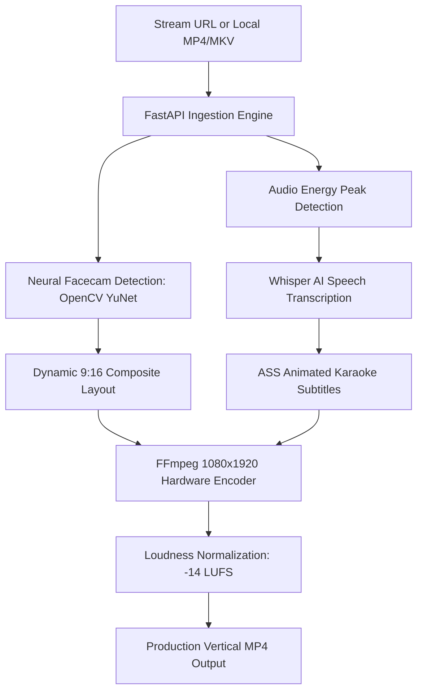

# Chopper

High-performance, on-device livestream clipping platform that transforms long Twitch and YouTube VODs into viral 1080p vertical shorts for TikTok, YouTube Shorts, and Instagram Reels.


## Overview

Chopper ingests hours of raw livestream footage and automates the entire vertical content workflow locally on your hardware.

* **Automated Facecam Isolation**: Neural face tracking locates the streamer camera in the stream frame and pins it above full gameplay.
* **Acoustic Peak Detection**: Analyzes decibel spikes, laughter bursts, and sudden volume transitions to detect clutch plays and viral moments.
* **Animated Karaoke Subtitles**: Local Whisper AI transcribes spoken audio into word-accurate, synchronized ASS vertical captions.
* **100% Local Execution**: All rendering, audio processing, and transcription run directly on your CPU and GPU with zero cloud subscription fees and complete footage confidentiality.

## Architecture



### Processing pipeline

1. **Ingestion & Stream Verification**: Resolves stream source (via `yt-dlp` or local upload), verifies container codecs, and extracts keyframe metadata.
2. **Highlight Discovery**: Computes root-mean-square (RMS) energy windows across the audio track to pinpoint high-energy segments (laughter, shouts, clutch moments).
3. **Facecam Localization**: Analyzes stream quadrants using the OpenCV YuNet ONNX face detection model to crop the camera feed and generate framing coordinates.
4. **Whisper Transcription**: Generates word-level timestamps and formats animated ASS karaoke subtitle dialogue layers.
5. **Multi-layer Composite Rendering**: Merges top facecam crop, bottom gameplay crop, viral headline titlecard, and subtitles into a single 1080x1920 60 FPS output.
6. **Broadcast Audio Mastering**: Normalizes overall output loudness to -14 LUFS with a -1.5 dB true peak ceiling for mobile platform algorithms.

### Why on-device

Cloud-based clipping services charge recurring monthly subscriptions, throttle video length, and upload private creator VODs to remote servers. Chopper performs all computer vision, neural transcription, and video encoding locally, giving creators unlimited rendering capacity and complete control over their raw footage.

## Setup

### Prerequisites

* Python 3.10 or higher installed.
* FFmpeg installed and available in system `PATH`.
* Modern browser (Chrome, Edge, Firefox, Safari).

### Installation

1. **Clone repository:**

```bash
git clone https://github.com/abhinavv-13/chopper.git
cd chopper
```

2. **Install dependencies:**

```bash
pip install -r requirements.txt
```

3. **Start the backend server:**

```bash
python server.py
```

4. **Access the application:**

Open your web browser and navigate to:

```text
http://127.0.0.1:8000
```

## Workflows

### 1. URL Clipping

1. Paste any public YouTube or Twitch stream link into the input bar.
2. Select desired clip duration (30s, 45s, 60s).
3. Click **Chop Stream**.
4. The Chopper HUD displays real-time processing passes (Facecam Locking, Audio Peak Slicing, Caption Burn-in).
5. Preview clips in the batch modal and download final 1080p MP4 files.

### 2. Local File Upload

1. Drag and drop any `.mp4`, `.mkv`, `.mov`, or `.webm` recording onto the upload zone.
2. Select target duration and trigger processing.
3. Review auto-framed vertical clips directly in the browser player.

## Project structure

```text
chopper/
├── sc/                     # Core video AI and clipping engine
│   ├── common.py           # FFmpeg wrappers, audio filters, loudness normalization
│   ├── frame.py            # Neural facecam detection and 9:16 layout composition
│   ├── highlights.py       # Audio volume spike and energy segment discovery
│   ├── listen.py           # Whisper speech-to-text and subtitle timing
│   ├── pipeline.py         # Multi-stage automated clipping pipeline
│   ├── produce.py          # 1080p vertical rendering orchestrator
│   ├── subs.py             # ASS karaoke subtitle generation
│   └── titlecard.py        # Top headline card rendering
├── static/                 # Production web frontend
│   ├── assets/             # Branding graphics, mascot animation, showcase clips
│   ├── index.html          # Interactive single-page application
│   ├── 404.html            # 404 error page
│   ├── privacy.html        # Privacy policy documentation
│   ├── terms.html          # Terms of service documentation
│   ├── chopper-loader.js   # Interactive Chopper HUD web component
│   └── sonner.css          # Toast notification styles
├── uploads/                # Local stream storage directory
├── exports/                # Generated 1080p vertical clips
├── server.py               # FastAPI application and REST endpoints
├── requirements.txt        # Python dependency manifest
├── .gitignore              # Git ignore rules
└── README.md
```

## Code reference

| Module | Responsibility |
|--------|----------------|
| `server.py` | FastAPI application entry point, API routing, security middleware, and file streaming. |
| `sc/frame.py` | Computer vision module; detects facecam position and builds 1080x1920 split-screen crop coordinates. |
| `sc/listen.py` | Audio transcription module using Faster-Whisper for high-speed word-accurate timestamp generation. |
| `sc/highlights.py` | Acoustic energy detector; parses audio streams for decibel spikes and laughing bursts. |
| `sc/subs.py` | Formats word-level subtitle timings into stylized, centered ASS vertical karaoke captions. |
| `sc/produce.py` | Constructs complex FFmpeg filtergraphs for dual-stream video stitching and hardware-accelerated exports. |
| `sc/common.py` | Audio normalization (-14 LUFS filter), FFmpeg execution safety, and system font discovery. |

## Design decisions

* **OpenCV YuNet ONNX**: Uses an ultra-lightweight neural face detection model that runs in real time on standard CPUs without requiring expensive CUDA hardware.
* **Faster-Whisper Integration**: Uses CTranslate2 quantized models for 4x faster transcription speed and reduced RAM usage compared to standard OpenAI Whisper.
* **Complex Filtergraph Piping**: Streams facecam crops, gameplay crops, and subtitles in a single FFmpeg execution pass to avoid intermediate disk writes and quality loss.
* **Zero Cloud Architecture**: Designed strictly for on-device operation, ensuring user data privacy and zero API rate limits.

## Limitations

* Streams without speech or audible dialogue will export without subtitle overlays.
* Initial Whisper model load requires an active internet connection to download model weights (subsequent runs execute 100% offline).
* Hardware encoding speed depends on local CPU and GPU capabilities (Intel QSV, NVIDIA NVENC, and Apple Silicon supported via FFmpeg).

## Troubleshooting

| Symptom | Cause and fix |
|---------|---------------|
| `ffmpeg: command not found` | FFmpeg is not installed or missing from PATH. Install FFmpeg and verify with `ffmpeg -version`. |
| Port 8000 already in use | Another service is using port 8000. Stop the process or run `uvicorn server:app --port 8080`. |
| Facecam not detected | Streamer camera may be obscured or unlit. Chopper automatically falls back to centered gameplay crop. |
| Stream download error | Source stream may be private, geoblocked, or members-only. Test stream URL accessibility in a browser. |

## Author

Abhinav ([@abhinavv-13](https://github.com/abhinavv-13))

## License

MIT
